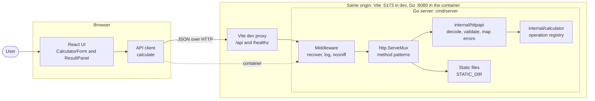
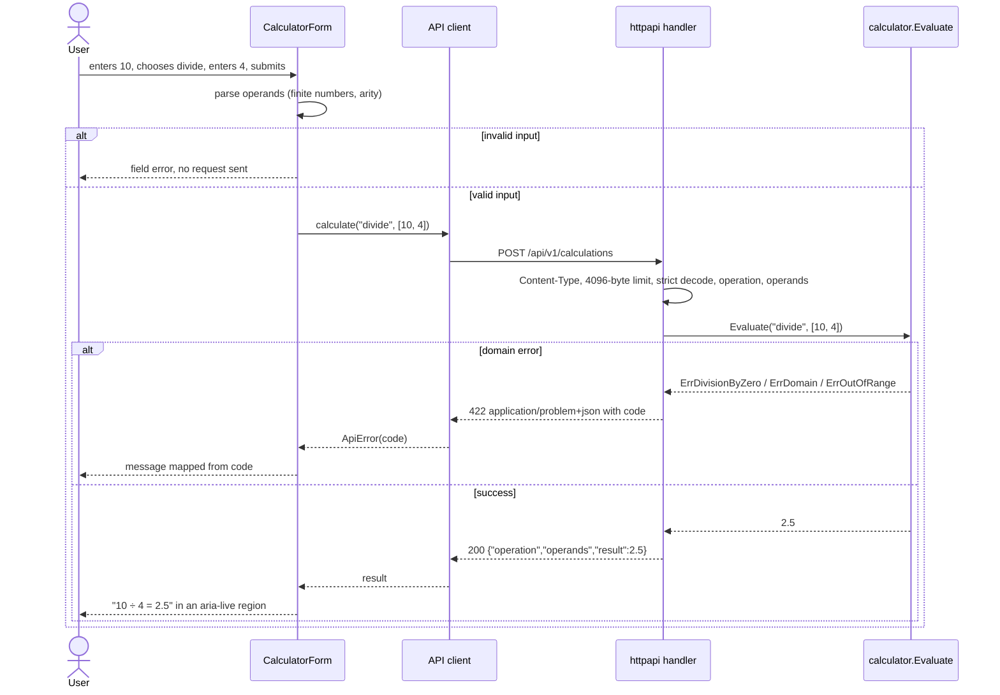

# Architecture

## Context

A browser UI collects one operation and its operands, sends them to a stateless Go service and shows the result
or a precise error. The two sides are built in parallel and share only [`docs/api/`](api/). The design goal is
that each layer has one job, so every rule lives in exactly one place:

- **Arithmetic and its edge cases** live in the backend domain package.
- **HTTP concerns** (parsing, validation, status codes, problem documents) live in the backend transport package.
- **Presentation concerns** (input parsing for the form, display formatting, user-facing messages) live in the frontend.

## Components



## Sequence of a calculation



## Layers and responsibilities

### Backend (`backend/`, Go standard library only)

| Package | Responsibility | Knows about HTTP? |
|---------|----------------|-------------------|
| `internal/calculator` | Pure domain: the operation registry (id → arity and function), evaluation, result normalization (`-0` → `0`, ±Inf → `ErrOutOfRange`, NaN → `ErrDomain`) and sentinel errors. | No |
| `internal/httpapi` | Transport: routes, `Content-Type` check, body limit, strict JSON decoding, operand parsing, mapping domain errors to status and `code`, problem documents, middleware. | Yes |
| `cmd/server` | Configuration from the environment, logger, `http.Server` with timeouts, graceful shutdown. | Wiring only |

Domain shape (guidance for task 2, names may differ):

```go
// Strategy pattern: adding an operation is one registry entry plus its tests.
type Operation struct {
	Arity int
	Apply func(operands []float64) (float64, error)
}

var registry = map[string]Operation{
	"add":    {Arity: 2, Apply: func(x []float64) (float64, error) { return x[0] + x[1], nil }},
	"divide": {Arity: 2, Apply: divide}, // returns ErrDivisionByZero for 0 and -0
	// ...
}

var (
	ErrUnsupportedOperation = errors.New("unsupported operation")
	ErrArity                = errors.New("wrong number of operands")
	ErrDivisionByZero       = errors.New("division by zero")
	ErrDomain               = errors.New("operation undefined for operands")
	ErrOutOfRange           = errors.New("result out of float64 range")
)
```

`httpapi` maps errors with `errors.Is`: `ErrUnsupportedOperation` → 400 `UNSUPPORTED_OPERATION`,
`ErrArity` → 400 `INVALID_OPERANDS`, `ErrDivisionByZero` → 422 `DIVISION_BY_ZERO`, `ErrDomain` → 422
`DOMAIN_ERROR`, `ErrOutOfRange` → 422 `RESULT_OUT_OF_RANGE`, anything else → 500 `INTERNAL_ERROR`.

Transport notes for task 2:

- Decode `operands` as `[]json.RawMessage` and parse each element on its own, so `null`, strings and
  out-of-range numbers (`1e400`) become `INVALID_OPERANDS` rather than a generic decode error.
- After decoding the object, a second decode must hit `io.EOF`; anything else is `INVALID_JSON`.
- Register `/api/v1/calculations` for all methods and answer anything but `POST` with 405 and `Allow: POST`.
  With Go 1.22 patterns, a `POST`-only route plus an `/api/` catch-all would turn a wrong method into a 404.
- `/api/` (catch-all) returns 404 `NOT_FOUND` as a problem document. Outside `/api/`, Go's defaults apply.

### Frontend (`frontend/`, React with TypeScript and Vite)

| Module | Responsibility |
|--------|----------------|
| `src/api/` | Contract types and `calculate(operation, operands)`, which calls `fetch` on a relative URL and returns the result or throws an `ApiError` carrying `code`. It also validates that the response has the expected shape. |
| `src/calculator/` | Pure functions: the operation list (id, label, symbol, arity), `parseOperand`, `formatResult` and the `code` → message map. |
| `src/components/` | `CalculatorForm` (inputs, operation selector, submit, field errors) and `ResultPanel` (result or error in an `aria-live` region). |
| `src/test/` | Test setup, fixture loading from `docs/api/examples/` and the MSW server. |

UI state is local React state. The request lifecycle is one discriminated union:
`idle | loading | success(result) | error(message)`.

## Target folder structure

```text
backend/
  go.mod                        module, go 1.22, no require block
  cmd/server/main.go            config, logger, server, shutdown
  internal/calculator/
    calculator.go               registry, Evaluate, normalization
    errors.go                   sentinel errors
    calculator_test.go          table-driven tests per operation and edge case
  internal/httpapi/
    router.go                   NewHandler: routes, static files, middleware
    calculations.go             POST handler
    decode.go                   Content-Type, size limit, strict decoding, operand parsing
    problem.go                  problem+json writer, error → status/code mapping
    middleware.go               recover, access log, nosniff
    *_test.go                   unit tests and contract_test.go over docs/api/examples
frontend/
  index.html
  package.json                  scripts: dev, build, preview, test, typecheck
  vite.config.ts                dev server :5173, proxy, Vitest config and coverage thresholds
  tsconfig.json
  src/
    main.tsx, App.tsx, styles.css
    api/types.ts, api/calculations.ts (+ tests)
    calculator/operations.ts, parseOperand.ts, formatResult.ts, errorMessages.ts (+ tests)
    components/CalculatorForm.tsx, ResultPanel.tsx (+ tests)
    test/setup.ts, test/fixtures.ts, test/server.ts
```

Files stay under 500 lines; split by responsibility when one grows.

## Ports and environment

| Name | Default | Used by | Meaning |
|------|---------|---------|---------|
| `PORT` | `8080` | backend | TCP port the server listens on. |
| `STATIC_DIR` | unset | backend | When set, must be an existing directory; its files (the frontend build) are served at `/`. When unset, only the API and `/healthz` are served. |
| Vite dev server | `5173` | frontend | `npm run dev`; proxies `/api` and `/healthz` to `http://localhost:8080`. |
| Container | `8080` | Docker | One image: Go serves the SPA (`STATIC_DIR`) and the API from the same origin (task 4). |

The frontend has no environment variables: it always calls relative URLs.

## Error model

All API errors are RFC 9457 `application/problem+json` documents:
`{"type":"about:blank","title":"<http.StatusText>","status":<int>,"detail":"<text>","code":"<CODE>"}`.
The full table, with every status, `code` and trigger, plus the validation order, is in the `info.description` of
[`openapi.yaml`](api/openapi.yaml). In short:

- 400 `INVALID_JSON`, `UNSUPPORTED_OPERATION`, `INVALID_OPERANDS`; 404 `NOT_FOUND` and 405
  `METHOD_NOT_ALLOWED` under `/api/`; 413 `PAYLOAD_TOO_LARGE`; 415 `UNSUPPORTED_MEDIA_TYPE`.
- 422 `DIVISION_BY_ZERO`, `DOMAIN_ERROR`, `RESULT_OUT_OF_RANGE` for well-formed requests the math rejects.
- 500 `INTERNAL_ERROR` with a generic `detail`; the cause goes to the log only.

The frontend branches on `code` only and shows its own English message for each; `detail` is never parsed.

## Numeric model

- Operands and results are IEEE-754 float64 in both layers (Go `float64`, JavaScript `number`).
- The server rejects inputs outside the float64 range, never returns NaN or ±Infinity, normalizes `-0` to `0`
  and does not round. Edge rules: `power(0, 0) = 1`; underflow to `0` is valid; `percentage` falls back to
  `(a / 100) × b` when `a × b` overflows.
- The client formats for display only: 0, or a magnitude in [1e-6, 1e12), is shown as a decimal rounded to 12
  significant digits with trailing zeros removed; any other magnitude uses exponential notation with up to 12
  significant digits.
- Why not decimal, and what a payments system would do instead: see
  [ADR 0003](adr/0003-float64-numeric-model-with-client-formatting.md).

## Test strategy

| Layer | Tools | Focus | Line coverage target |
|-------|-------|-------|----------------------|
| `internal/calculator` | `go test`, table-driven | Every operation; `-0` divisor; negative `sqrt`; `power` domain rules and overflow; `percentage` fallback; normalization of `-0`, NaN and ±Inf. | ≥ 95 % |
| `internal/httpapi` | `go test`, `net/http/httptest` | Contract test over every example; 413 at 4097 bytes; `charset` variants; trailing JSON; 404 and 405 with `Allow`; panic → 500 without details. | ≥ 85 % |
| `cmd/server` | `go test` where logic exists | Configuration parsing (`PORT`, `STATIC_DIR`). | Reported, no target |
| `frontend` | Vitest, Testing Library, MSW, jsdom | `formatResult`, `parseOperand`, error mapping; form behavior for every example; network failure; unary operation hides operand B. | ≥ 85 % |

Planned commands (they exist once tasks 2 and 3 land):

```sh
cd backend && go test -coverprofile=coverage.out ./... && go tool cover -func=coverage.out
cd frontend && npm test          # vitest run --coverage, fails under the thresholds
```

TDD applies to the domain, the decoding and validation rules, `parseOperand` and `formatResult`: write the
failing test first, then the code.

## Branches and worktrees

One short-lived branch per task. Parallel tasks get their own worktree, so two agents never share a working tree.

| Task | Branch | Folder | Starts after | Content |
|------|--------|--------|--------------|---------|
| 1 | `feat/foundation` | `C:\Users\joshe\Desktop\AssessmentSezzle` | — | Spec, contract, architecture, ADRs, agent rules, skills. Merged into `main` before tasks 2 and 3 start. |
| 2 | `feat/backend-api` | `C:\Users\joshe\Desktop\AssessmentSezzle.worktrees\feat-backend-api` | Task 1 merged | `backend/` only. |
| 3 | `feat/frontend-ui` | `C:\Users\joshe\Desktop\AssessmentSezzle.worktrees\feat-frontend-ui` | Task 1 merged | `frontend/` only. Runs in parallel with task 2. |
| 4 | `feat/delivery` | `C:\Users\joshe\Desktop\AssessmentSezzle` | Tasks 2 and 3 done | Integrates both branches with `forge_integration`, then Dockerfile, CI, coverage report, final README and AI workflow docs. |

Worktrees are created from the main folder, on `main`, after task 1 is merged:

```sh
git worktree add ../AssessmentSezzle.worktrees/feat-backend-api -b feat/backend-api main
git worktree add ../AssessmentSezzle.worktrees/feat-frontend-ui -b feat/frontend-ui main
```

Tasks 2 and 3 touch disjoint folders (`backend/` and `frontend/`) and never edit `docs/api/`, so their merge
is conflict-free by construction. Shared files they might both want to change (README, `.gitignore`) are left
to task 4.
